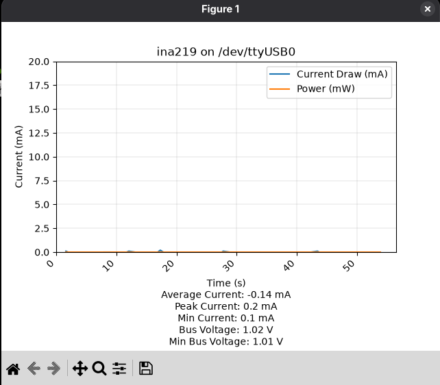
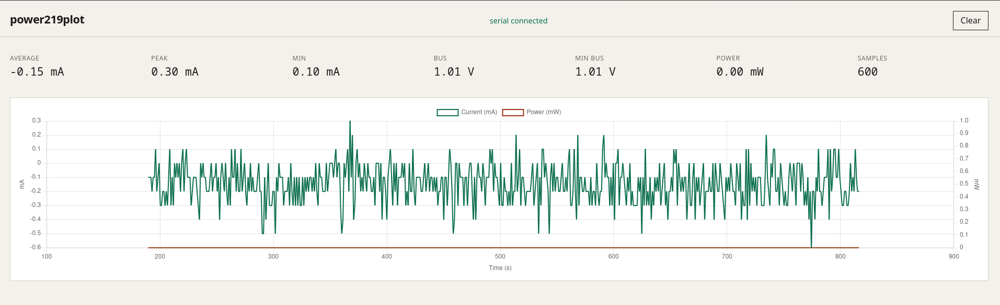

# power219plot

Personal high-side current/power logger built around an [Adafruit INA219 breakout](https://www.adafruit.com/product/904), an Arduino Nano, an SSD1306 OLED, a custom KiCad PCB, and a FreeCAD enclosure.

Firmware samples about once per second and streams **NDJSON** over serial at 115200 baud. Two host apps consume that stream for live charts and stats.

## Current state

| Piece | Status |
|-------|--------|
| Firmware (`arduino/`) | PlatformIO, Nano + INA219 + OLED; NDJSON UART; signed-current safe |
| Desktop plotter (`host/python-chart/`) | Matplotlib live chart, CLI port/baud, Ctrl-C shutdown, `results.jsonl` log |
| Web dashboard (`host/webapp/`) | Minimal Flask UI, rolling chart + stats, optional JSONL log |
| Hardware (`hw/`) | KiCad PCB (Nano + GY-219 / INA219 + OLED footprints) |
| Enclosure (`3dcase/`) | FreeCAD case + STL/3MF exports |

Serial sample format:

```json
{"bus_V":1.01,"shunt_mV":-0.01,"load_V":1.01,"current_mA":-0.20,"power_mW":0.00}
```

### Desktop plotter



See [`host/python-chart/README.md`](host/python-chart/README.md).

### Web dashboard



See [`host/webapp/README.md`](host/webapp/README.md).

Do not run both host apps against the same serial port at once.

## Repository layout

```
arduino/          PlatformIO firmware
host/python-chart Matplotlib plotter
host/webapp       Flask dashboard
hw/               KiCad + Fritzing sketches
3dcase/           FreeCAD enclosure
img/              Screenshots
```

## Sensing limits (stock setup)

Hardware today: **unmodified Adafruit INA219** (#904) with the onboard **0.1 Ω, 1%** shunt. Firmware still uses the library **default calibration (32V / 2A)** unless you change it.

| Mode | Approx. full-scale current | Approx. current LSB |
|------|----------------------------|---------------------|
| Default `32V / 2A` (current firmware) | ~±3.2 A (board limit) / 2 A cal | ~**0.8 mA** |
| `setCalibration_32V_1A()` | ~1 A | ~**0.4 mA** |
| `setCalibration_16V_400mA()` | ~400 mA | ~**0.05–0.1 mA** (50–100 µA) |

What that means in practice:

- This build is a **milliamp-class** logger. Idle/noise on the order of **±0.1–0.5 mA** (as in the screenshots) is expected near zero load.
- **Microamp / sub-µA** measurement is **not** achievable with the stock 0.1 Ω shunt. At 1 µA the shunt drop is only 0.1 µV; the INA219 shunt ADC LSB is 10 µV.
- Software-only improvement: enable `setCalibration_16V_400mA()` for better low-mA resolution (still not true µA).
- Hardware path for µA work: replace the shunt with a much larger resistor (e.g. 100 Ω–1 kΩ sized to max expected current), recalibrate for the new `Rshunt`, and zero the offset with no load. INA219 input offset still limits absolute accuracy in the nanoamp range.

Bus voltage: high-side sensing up to about **+26 V** on the Adafruit breakout (INA219 absolute max is higher; stay within the breakout rating).
